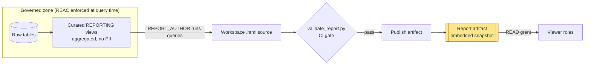

# snowflake-html-reports

Production patterns for **Snowflake HTML reports (Public Preview, released Nov 4, 2026)**: a governance-first way to build, validate and publish self-contained HTML Report artifacts from Snowsight Workspaces, CoCo Desktop, or Snowflake CoWork.

> A published report is a **data export with a URL**. Viewers see the embedded query results even if they can't query the source tables. This repo treats publishing as a release, not a save.

## What's here

| Path | Purpose |
|---|---|
| `docs/` | Architecture, security model, runbook, limitations, verification notes |
| `sql/` | RBAC for authors and publishers, curated snapshot views, exposure audit queries |
| `reports/finops-credits/report.html` | Sample report generated by CoCo in a Snowsight Workspace from a real `ACCOUNT_USAGE` snapshot (2026-11-15). Not yet published as an artifact |
| `scripts/validate_report.py` | Pre-publish linter (112 lines, no dependencies): blocked constructs, network calls, size budget, sensitive column names, metadata block |
| `tests/` | pytest suite for the validator (11 tests) |
| `.github/workflows/ci.yml` | Ruff lint, tests and report validation on every push and PR |

## The article and where its code lives

`MEDIUM.md` (about 2,500 words, a 9–10 minute read) follows the Snowflake Medium guidelines: a hook in the first lines, TL;DR, learning outcomes, step-by-step code, images, a summary and three tags. Each section maps to a file in this repo:

| Article section | Repo file |
|---|---|
| Step 1: Check who can share (audit, wrong privilege, fix) | `sql/03_audit.sql`, `sql/01_rbac.sql` |
| Step 2: Constrain what authors can see | `sql/01_rbac.sql`, `sql/02_snapshot_views.sql` |
| Step 3: Gate publishing with a validator | `scripts/validate_report.py`, `tests/`, `.github/workflows/ci.yml` |
| Step 4: Know the kill switch | `sql/03_audit.sql` (query 2), `docs/security-model.md` |
| How I generated the sample report | `reports/finops-credits/report.html` |
| Production reality | `docs/production-runbook.md`, `docs/limitations.md` |
| Verification notes | `docs/verification-notes.md` |

**Before publishing the article:** replace `<your-org>` in its two GitHub links and add the four images it references under `images/` (`01-before-after.png`, `02-audit-output.png`, `03-publish-pipeline.png`, `04-sample-report.png`). The `images/` folder doesn't exist yet. `LINKEDIN.md` is the companion post for sharing it.

## Generating a report with CoCo

The sample report was made this way. For the full walkthrough, see "How I generated the sample report" in `MEDIUM.md`.

1. In a Snowsight Workspace, select **Report** from the new-file menu, or open a CoCo chat, and describe the data, charts and layout you want.
2. Review the SQL CoCo runs. **Whatever it returns, every reader will see.**
3. CoCo writes a self-contained `.html` with the data inline, vendored libraries from `/libs/`, no inline handlers, and a `snowflake-report-metadata` block recording the SQL.
4. Commit the file under `reports/<name>/report.html` and let CI run the validator.
5. Publish with **Publish artifact**, granting **Can view** or **Can publish** to named roles.

## Before you start: check your account

On the account I tested, `PUBLIC` holds `MANAGE ACCESS ON REPORT ARTIFACTS`, along with the equivalent privileges for Chart, Dashboard, File and Thread artifacts. **Any user can share a report containing whatever their role can query.** Check yours:

```sql
SHOW GRANTS ON ACCOUNT
->> SELECT "privilege", "grantee_name" FROM $1
    WHERE "privilege" ILIKE 'MANAGE ACCESS ON % ARTIFACTS'
       OR "privilege" = 'MANAGE ARTIFACT PUBLICATION';
```

`MANAGE ARTIFACT PUBLICATION` will probably show up on `PUBLIC` too. It's a legacy dashboard-publishing privilege from a canceled behavior change, and Snowflake documents it as slated for removal. **Revoking it doesn't restrict report sharing.**

## Architecture



Anything to the right of **Publish** is outside table-level RBAC. Masking and row access policies applied once, to the author. Access then depends only on the grants on the artifact.

## Quickstart

```bash
python -m venv .venv && . .venv/bin/activate
pip install -e ".[dev]"
pytest -q                                              # 11 passed
ruff check .
python scripts/validate_report.py reports/*/report.html --strict
```

In Snowflake, review each file first and run them in order:

| File | Runs as | What it does |
|---|---|---|
| `sql/01_rbac.sql` | `SECURITYADMIN`, then `ACCOUNTADMIN` | Creates `REPORT_AUTHOR`, `REPORT_PUBLISHER` and `REPORT_VIEWER_*`; **revokes report sharing from `PUBLIC`** and grants it to `REPORT_PUBLISHER` |
| `sql/02_snapshot_views.sql` | `SYSADMIN` | Creates `REPORTING_DB.REPORTING` and a secure, pre-aggregated credits view; grants read access to `REPORT_AUTHOR` |
| `sql/03_audit.sql` | A role that can see account grants | Lists who can share artifacts, the sharing kill-switch setting, and the users holding `REPORT_PUBLISHER` |

> **Warning:** the REVOKE in `01_rbac.sql` changes who can share reports across the whole account. Tell report authors before you run it.

`02_snapshot_views.sql` reads `SNOWFLAKE.ACCOUNT_USAGE`. SYSADMIN had that access on the test account, but check that it does on yours.

**Kill switch** (account-wide, blocks all artifact sharing): `ALTER ACCOUNT SET ENABLE_SNOWFLAKE_INTELLIGENCE_ARTIFACT_SHARING = FALSE;`

## Publishing workflow

1. Author or refresh the report in Workspaces as `REPORT_AUTHOR` (CoCo writes the `.html`).
2. Commit the `.html` to this repo and open a PR. CI runs the validator.
3. A reviewer checks the **embedded data**, not just the layout.
4. A `REPORT_PUBLISHER` publishes and grants `READ` to named audience roles. Don't grant to `PUBLIC` without a written reason.
5. To update, refresh, re-validate and republish. The URL stays the same.
6. If sensitive data leaks, revoke the grants or delete the artifact **first**. Fixing the source file changes nothing for readers until you republish.

## Decision guide

| Use HTML reports when | Use something else when |
|---|---|
| Narrative, presentation or async exec updates | Viewers need live data under their own role, so use dashboards or Streamlit |
| The audience shouldn't need warehouse or table access | Row-level security must apply per viewer |
| A point-in-time snapshot is the right semantics | You need scheduled refresh or delivery (not supported in preview) |

## Verification status

The repo was fact-checked on 2026-11-15 against a live account and the Snowflake docs. Full detail is in [`docs/verification-notes.md`](docs/verification-notes.md).

| Area | Status |
|---|---|
| `sql/01`, `sql/02`, `sql/03` | **Executed.** Every statement ran on a live account using throwaway role and database names, dropped afterwards. |
| GRANT/REVOKE `MANAGE ACCESS ON REPORT ARTIFACTS ON ACCOUNT` | **Executed** against a throwaway role |
| Audit query (`SHOW GRANTS ->> SELECT`) | **Executed**, 13 rows |
| Python | **Executed.** 11/11 tests pass, ruff is clean, `pip install -e ".[dev]"` works, the sample report has 0 findings |
| PUBLIC default and snapshot semantics | **Verified** in the docs and on the live account |
| REVOKE from `PUBLIC`, kill switch | **Deliberately not executed** (both affect the whole account) |
| `/libs/` paths rendering in a published artifact | **Not verified** |
| Sample report published or refreshed via **Refresh report** | **Not done yet** |
| `ruff-pre-commit v0.6.9` tag, GitHub Actions run | **Not verified** (the sandbox has no GitHub access; the repo isn't pushed yet) |

**Why there's no SQL linter:** sqlfluff's Snowflake dialect can't parse `->>` or `REVOKE MANAGE ACCESS ON REPORT ARTIFACTS`, both of which run fine on Snowflake. The SQL is verified by running it instead.

## License
Apache-2.0
