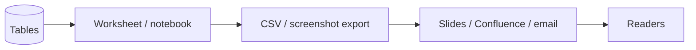
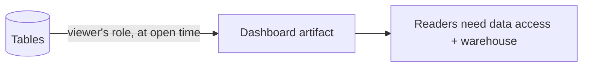
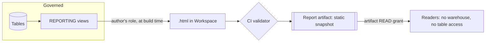

# Architecture

## Before: how teams shared "a report" without HTML reports

Every hop is outside Snowflake: there's no grant model, no single URL, and stale copies are everywhere.

## Option B: caller's-rights dashboards

## After: HTML Report artifact

The architectural delta is **when and as whom** data access is evaluated:

| | Dashboard / Chart artifact | Report artifact |
|---|---|---|
| Executes SQL on open | Yes (caller's rights) | No |
| Viewer needs source access | Yes | No |
| Viewer needs a warehouse | Yes | No |
| Data freshness | Live | Snapshot at last refresh |
| Access boundary | Table/row/column policies | Artifact grant |
